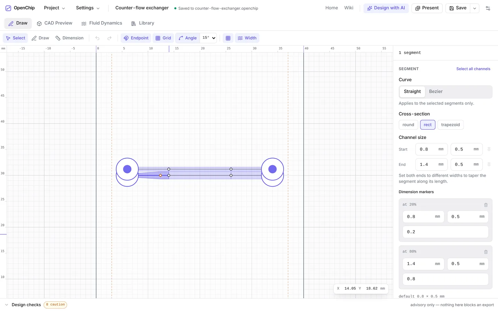
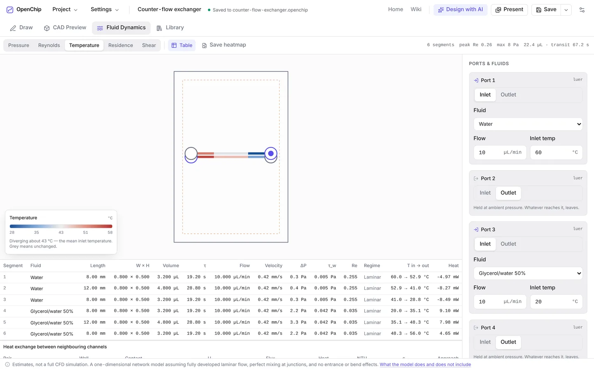

# OpenChip

[](https://doi.org/10.5281/zenodo.23461556)

**Design microfluidic chips in your browser and print them on a desktop resin printer.**

Draw a channel network, size every channel, add standard fittings, check it
against your printer, estimate the flow, and export a print-ready STL. It runs
entirely in your browser, with no account, no server and no network connection
needed.

**[Open the app →](https://app.openchip.tech)** · **[Documentation](https://wiki.openchip.tech)** · **[Website](https://openchip.tech)**

<picture>
  <source media="(prefers-color-scheme: dark)" srcset=".github/images/draw-dark.webp">
  
</picture>

## What it does

- **Draw channel networks** with straight and curved (bezier) segments, snapping
  and millimetre rulers. Set a channel's width and height anywhere along it and
  it tapers smoothly between them, across a whole path if you like.
- **Ports and fittings** from a catalogue: Luer slip and Luer-lock sockets,
  male Luer cones, hose barbs, syringe sockets, or your own dimensions.
- **A real 3D model**, built in the browser with
  [manifold-3d](https://github.com/elalish/manifold). Print it as two pieces
  (a channel plate and a lid), as one sealed block, or as an open plate capped
  with a glass microscope slide.
- **Design checks against your printer.** Channels below your printer's
  resolution, walls too thin to survive, features too close to the edge,
  trapped resin, unsupported overhangs. Every check is a warning that explains
  the risk; none of them ever blocks an export.
- **Flow estimates** from a one-dimensional network model: pressure drop,
  Reynolds number, wall shear, residence time, heat exchange between
  neighbouring channels, reagent use and throughput, with heatmaps.
- **Export** STL for printing, editable OpenSCAD source, SVG schematics, and
  presentation-ready figures.
- **Starter templates**: serpentine, T- and Y-junction, herringbone and spiral
  mixers, a gradient generator, and a droplet generator, each fully editable.
- **Design with AI**: describe a chip in plain English and an AI assistant with
  the [`openchip-design` skill](skills/openchip-design/SKILL.md) lays it out,
  checks it and hands back a file to open. Works with the Claude app and with
  coding agents (`npx skills add Jujified/OpenChip`). OpenChip itself sends
  nothing anywhere.

<picture>
  <source media="(prefers-color-scheme: dark)" srcset=".github/images/fluid-dark.webp">
  
</picture>

## Try it

The quickest way is the hosted app at **[app.openchip.tech](https://app.openchip.tech)**.
Nothing you draw leaves your machine.

Open the **Library** tab and pick a template, or open
[`examples/counter-flow-exchanger.openchip`](examples/counter-flow-exchanger.openchip)
with **Project → Open Project**. Press `?` anywhere for keyboard shortcuts, or
take the guided tour from **Settings → Take the tour**.

Your working design is kept in browser storage as a safety net. To keep a design
or move it between machines, save it as a `.openchip` file.

## Run it locally

Requires Node 20.19 or newer.

```bash
git clone https://github.com/Jujified/OpenChip.git
cd OpenChip
npm install
npm run dev
```

| Script | Does |
| --- | --- |
| `npm run dev` | Start the dev server |
| `npm run build` | Typecheck, then build static files into `dist/` |
| `npm test` | Run the test suite |
| `npm run lint` | Lint with oxlint |
| `npm run typecheck` | Typecheck without emitting |

The build is plain static files, so any static host works. See
[ARCHITECTURE.md](ARCHITECTURE.md) for how the editor, CAD engine, design checks
and flow model are put together.

## What it does not do

OpenChip is a design tool, not a guarantee. The design checks are geometric
rules of thumb against a printer profile you enter, and resin, exposure and
post-curing all move the result. **Print a small test coupon before committing
to a full chip.** The flow estimates assume fully developed laminar flow and
perfect mixing at junctions; they size a chip and catch an unusable design, but
they are not a CFD simulation. Printed Luer fittings follow nominal ISO
80369-7 dimensions and are not certified connectors; do not use them in
anything clinical.

## Citing OpenChip

If OpenChip designed a device that appears in your work, please cite the
software and the version you used. The DOI is
[10.5281/zenodo.23461556](https://doi.org/10.5281/zenodo.23461556), and GitHub's
**Cite this repository** button gives the details from
[`CITATION.cff`](CITATION.cff).

```bibtex
@software{openchip,
  title   = {OpenChip: browser-based microfluidic chip design for resin printing},
  author  = {Cimoca, Julian},
  year    = {2026},
  version = {1.0.0},
  doi     = {10.5281/zenodo.23461556},
  url     = {https://openchip.tech}
}
```

## Related software

- **[Flui3d](https://github.com/TUM-EDA/Flui3d)** (Zhang et al.,
  *Communications Engineering*, 2024) is the closest relative: a web-based
  design platform for 3D-printed microfluidic chips. It builds devices from a
  parameterised component library, supports multi-layer designs, and corrects
  geometry for light penetration during printing. OpenChip instead draws
  freeform channel networks and focuses on printability checks, flow estimates
  and standard fittings, entirely client-side.
- **[3DμF](https://github.com/CIDARLAB/3DuF)** is an interactive design
  environment for continuous-flow microfluidic devices.

## Contributing

Bug reports, ideas and pull requests are welcome. See
[CONTRIBUTING.md](CONTRIBUTING.md). The documentation site and the website are
maintained separately from this repository.

## About

Created by Julian Cimoca
([ORCID 0009-0009-8978-5337](https://orcid.org/0009-0009-8978-5337)).
Developed with AI coding assistance (Claude); design, direction and validation
by the author.

## Acknowledgements

The author collaborated with, and received advice from, mentor Walker MacSwain
([ORCID 0000-0002-2671-2546](https://orcid.org/0000-0002-2671-2546)), who also
helped validate the software.

## License

Released under the [MIT License](LICENSE).
